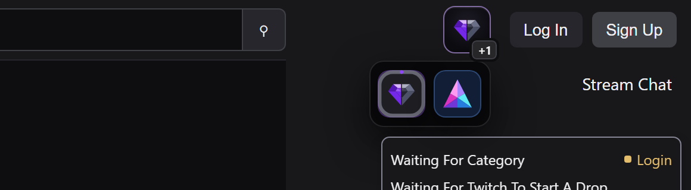

#  exp-core

The shared launcher, menus and settings controls bundled with ExtraPotions products. Nothing to install separately.

## Products

- [Dropper for Twitch](https://github.com/ExtraPotions/Dropper) — Drops progress, campaigns and inventory.
- [PRISMA](https://github.com/ExtraPotions/PRISMA) — LGBTQ+ identity highlights and definitions.
- [WARD](https://github.com/ExtraPotions/WARD) — Store-page filtering and colors.
- [Thread for Reddit](https://github.com/ExtraPotions/Thread) — Feed layouts, filters and local reading tools.

## Shared controls

Products keep their own colors and sections. Core provides one launcher when products share a page, Standard/Compact/Mini menu sizes, keyboard navigation, status and diagnostics.

Screenshot uses sample content. See each product’s README for its menu and installation link.

---

[Menu guide](docs/usage.md) · [Development](docs/development.md) · [Changelog](CHANGELOG.md) · [Code license](LICENSE-CODE.md) · [Artwork and documentation license](LICENSE-ASSETS.md)

exp-core is independent and is not affiliated with or endorsed by the websites where it is used. Retired-product compatibility is covered in the [menu guide](docs/usage.md).
