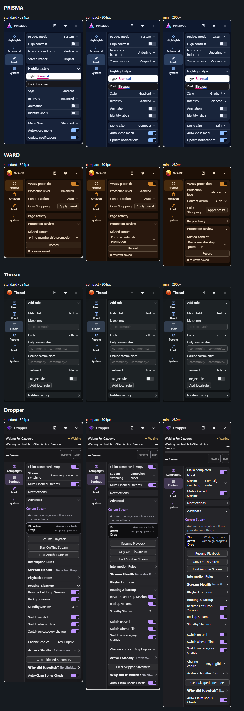

# ExtraPotions menu guide

[Back to Core](../README.md)

## Open a product

Install a product, not Core. Each product bundles the shared menu. When several products run on a page, open the shared launcher and choose one. Products keep their own features, colors and settings.

The launcher uses Twitch’s top bar and Thread’s Reddit rail placement where available. Elsewhere it uses a corner position; the corner launcher can be dragged vertically. Updates and Dropper progress can appear on the launcher.

## Menu size and navigation

Choose Standard, Compact or Mini in **Look → Menu Size**. Product sections appear in the side rail; secondary settings expand in place. Header buttons open the changelog, donations and Close. Support and Reset stay inside **System**.

## Status, help and recovery

**System** shows Working, Waiting, Paused or Needs attention and offers a recovery action when available. Use Show Diagnostics or Copy Diagnostics for troubleshooting, Report a Problem for support, and Reset All Settings only when you want to clear the product’s settings.

## More views

The capture uses sample pages and iPad touch emulation. Individual products maintain their own screenshots and usage guides.

## Maintenance

Core and products are separate repositories. See [development](development.md) for builds, synchronization, tests and explicitly authorized releases, or the [menu template](menu-template.md) for shared controls.

SHIFT is retired. Its repository, releases and settings are preserved, and Core retains compatibility with installed copies. It is excluded from routine maintenance and new installation packs. No other product requires SHIFT.
